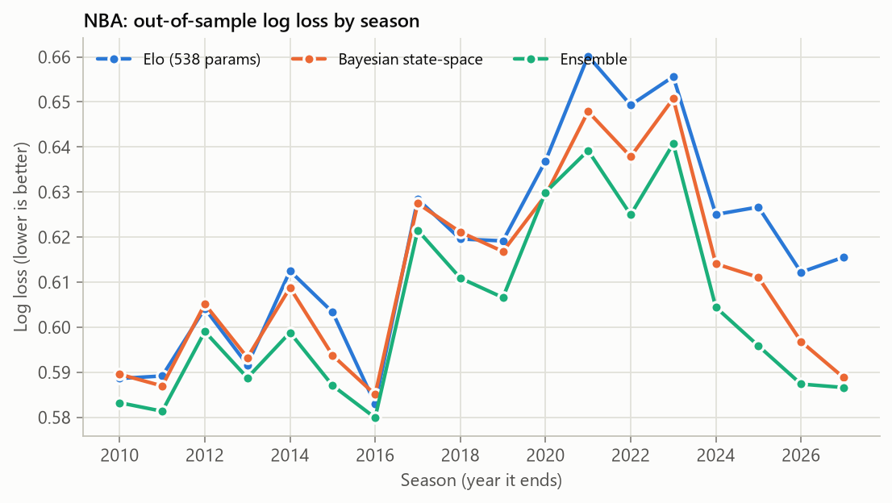
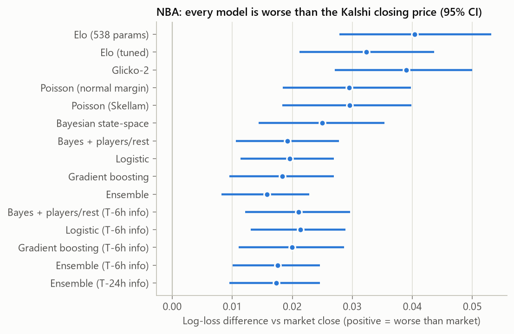
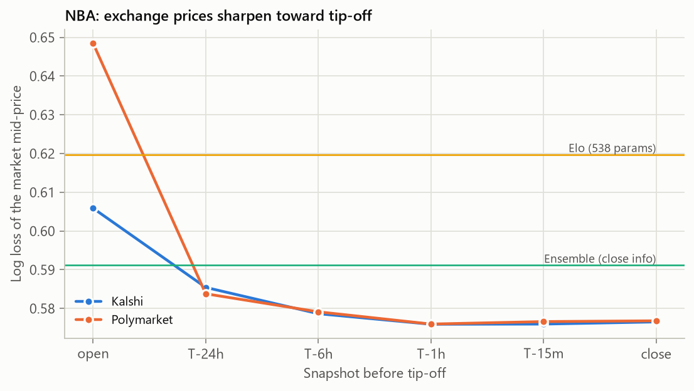
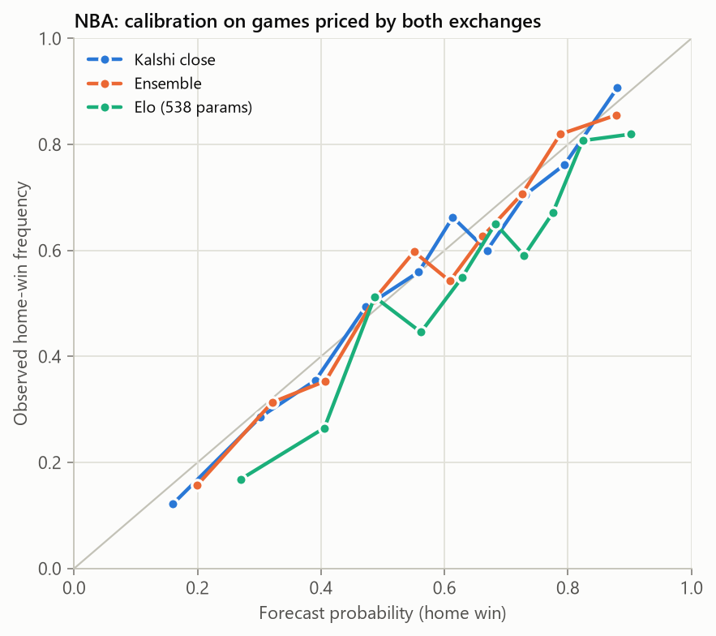
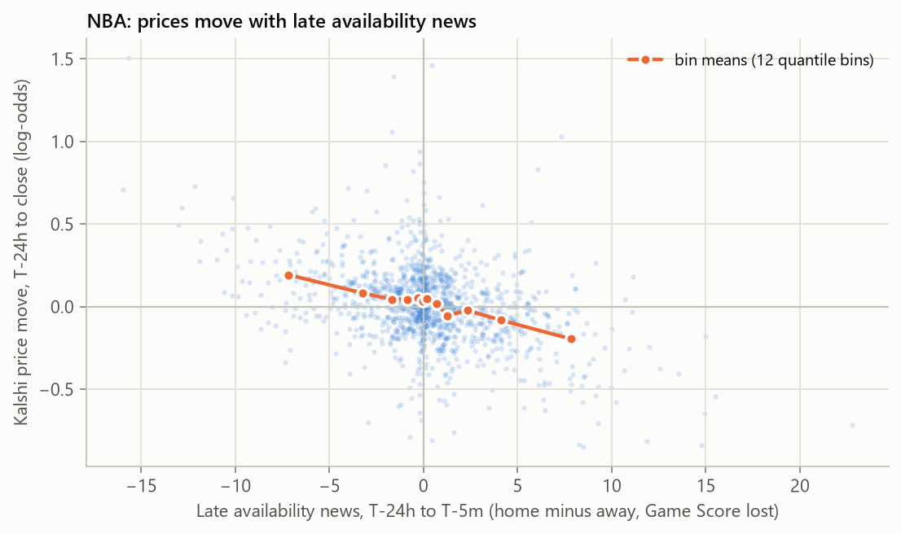
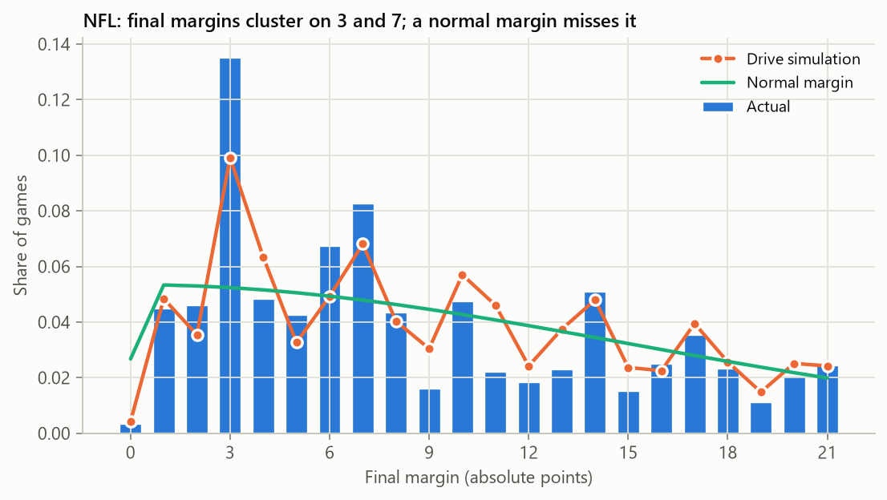
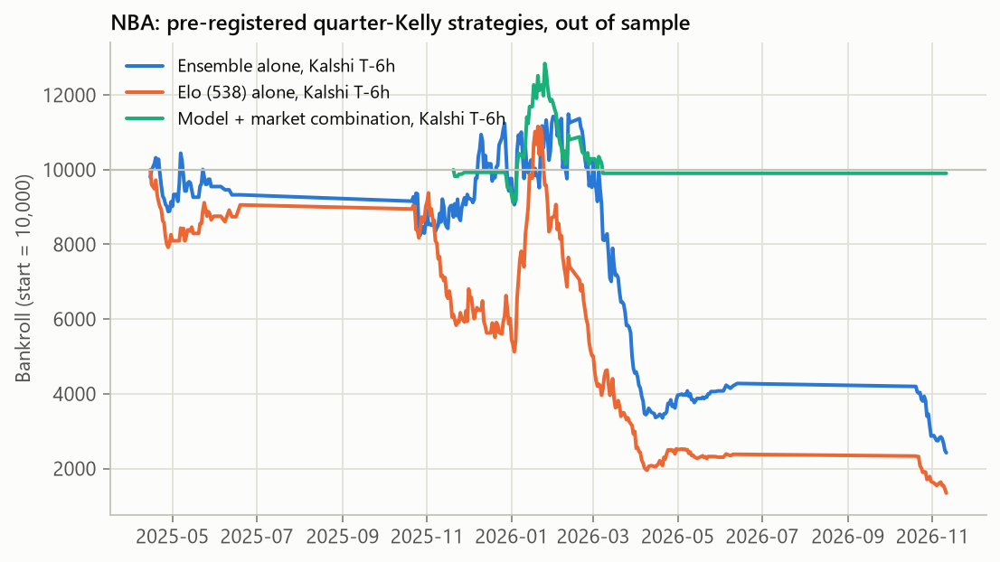

# Do models beat the closing line? Probability models against exchange and sportsbook prices in the NBA and NFL

Research note, November 2026. Every number below is generated from the result files in
<code>outputs/</code> by <code>scripts/build_paper.py</code>; the code and data pipeline are in this repository.

## Abstract

We assemble a leakage-controlled research platform from open data: NBA and NFL results, box scores,
official injury reports with publication timestamps, sportsbook closing lines (NFL), and order-book price
histories from two prediction-market exchanges, Kalshi and Polymarket. We fit Elo, Glicko-2, Poisson,
a Bayesian dynamic state-space model, player-availability adjustments, walk-forward logistic regression and
gradient boosting, and compare them with margin-free market probabilities. Across
14,338 out-of-sample NBA games the best model, an ensemble, lowers log loss
relative to FiveThirtyEight-style Elo by 0.0161 (95% CI 0.0132 to
0.0190). Against Kalshi closing prices on 1,556
games the same ensemble is worse by 0.0158 (95% CI 0.0082 to
0.0228), and in a forecast-encompassing regression its weight is
-0.10 (SE 0.17): the closing price already contains everything the
model knows. The NFL tells the same story against devigged sportsbook closing moneylines
(3,685 games). Schedule, fatigue and late injury news move prices but leave no
detectable residual in closing prices after correcting for 24 simultaneous tests.
Day-ahead prices are less efficient: the model's T-24h disagreement predicts the price's move to the close,
and bets placed 24 hours out beat the closing price by +1.06 points on average
(95% CI +0.72 to +1.40), but that is less than Kalshi's taker fee and
spread. Pre-registered fractional-Kelly strategies built on model-versus-market disagreement lose money after
costs, and the one decision rule that respects the evidence, a walk-forward combination of model and price,
mostly abstains. The one apparent exception, a player-points model that seemed to add information to Kalshi prop prices, was put to a pre-registered replication on 728 held-out games. It passed as registered (one-sided p = 0.0005), but a post-hoc check traced the signal in both samples to a scoring error: props on players who sat out were scored as losses, while Kalshi settles them at a pre-game fair price. Scored as they settle, the model's weight is 0.02 (SE 0.05). The result is a careful negative: on these markets, public-information models do not find
mispricing at the close that survives costs.

## 1. Question and approach

Sports betting markets are a clean laboratory for market efficiency: every contract settles on an observable
outcome within hours. The research question is whether probabilities built from public information
systematically disagree with market prices in a way that the outcomes vindicate. We deliberately do not
optimise for historical return; the yardstick is out-of-sample forecast accuracy measured with proper scoring
rules, calibration, forecast encompassing, and closing-line value (CLV), with betting simulations used only as
a stress test of those measurements under realistic costs.

Three design choices drive the results:

1. **Margin-free market probabilities.** Bookmaker prices are devigged with five methods (multiplicative,
   additive, power, Shin, odds-ratio). Exchange prices are mids of executable order books; Kalshi's two
   team-books are combined, and their ask-implied overround is reported as the exchange analogue of vig.
2. **Point-in-time information.** Every input carries a timestamp. Ratings update only with results from
   earlier calendar days; injury reports count only if published before the decision time; bets trade the ask
   that existed at the decision time.
3. **Out-of-sample by construction.** Rating hyperparameters are fitted on 2004-2015 (NBA) and 2002-2012 (NFL);
   learned models are walk-forward by season; the betting rules were fixed before any backtest was run.

## 2. Data

| Source | Content | Coverage used |
|---|---|---|
| sportsdataverse (MIT) | NBA schedules, box scores, official injury reports with publication time | 1996-97 to 2026-27; reports from Dec 2018 |
| nflverse (CC-BY-4.0) | NFL games, closing moneyline / spread / total with prices, starting QBs, weekly injuries, player stats | 1999 to 2026 |
| Kalshi public API | Game-winner order books: 1-minute and hourly bid / ask / trade candles | NBA Apr 2025 to Nov 2026; NFL Aug 2025 to Nov 2026 |
| Polymarket public API | Moneyline, spread and total price histories | NBA Apr 2024 to Nov 2026; NFL 2024 to 2026 |

All of it lands in a SQLite historical odds database (`data/db/sports.sqlite`) with UTC timestamps for
tip-off, result availability, every exchange quote and every injury report. Two candidate sources were
excluded: the SportsbookReviewsOnline archive, the longest free NBA sportsbook history, because its terms
forbid use without consent, and two odds-file sites whose robots.txt disallows Anthropic's crawlers.
`DATA_SOURCES.md` documents each check. The consequence is that NBA sportsbook history is absent and the NBA
market comparison rests on exchange prices from April 2024 onward.

Market samples (NBA): Kalshi closing prices for 1,556 games
(2025-04-15 to 2026-11-11), Polymarket for
1,532 (2024-04-20 onward), both
for 827. Kalshi's closing books are tight: the mean ask-implied
overround is 0.7% at the close against
7.4% at listing. The NFL sportsbook closing moneyline carries a
mean overround of 3.0%.

## 3. Models

* **Elo** with FiveThirtyEight's published NBA/NFL settings (K = 20, home edge 100 / 48 Elo points,
  margin-of-victory multiplier with autocorrelation correction, 75% / 67% carry-over) as the benchmark, and a
  version tuned by log loss on the training seasons.
* **Glicko-2** with per-game rating periods and deviation growth over idle days.
* **Poisson attack/defence** with exponential time decay, refitted every game day; win probabilities read
  out both as Skellam and as a Gaussian margin with an empirically tracked residual SD.
* **Bayesian dynamic state-space model**: team offence and defence follow random walks, league scoring level
  and home advantage are latent states, and a hierarchical prior partially pools teams toward the league mean
  each summer. Exact Kalman filtering yields the posterior after each game and the marginal likelihood used to
  fit hyperparameters by empirical Bayes; the predictive distribution gives moneyline, spread and total
  probabilities jointly.
* **Player availability (NBA)**: pre-game Game Score per 36 minutes and expected minutes for every player give
  the value a team loses when a player sits; expected absences come from the last official injury report
  before the decision time and are measured against what the ratings already absorbed.
  **Starting quarterback (NFL)**: pre-game EPA per play of the announced starter versus the previous starter.
* **Walk-forward logistic regression and LightGBM** on rating outputs, schedule, travel, altitude and
  availability features, and a **margin-adjusted state-space model**; the **ensemble** averages the three in
  log-odds. Three information sets (injury reports up to T-24h, T-6h, T-5m) are kept separate.
* **Monte Carlo simulators**: a possession model for the NBA (with player-points allocation for props) and a
  drive model for the NFL that reproduces scoring in 3s and 7s.

Fitted rating hyperparameters (training seasons only) are in `outputs/<league>/params.json`; for example the
tuned NBA Elo uses K = 9.6 and a home edge of
82 Elo points, and the state-space model's fitted season carry-over is
0.61.

## 4. NBA moneyline: models against each other

Out-of-sample seasons 2015-16 to 2026-27 (14,338 games):

| Model | Log loss | Brier | Accuracy | Calibration slope | ECE |
|---|---:|---:|---:|---:|---:|
| Elo (538 params) | 0.6282 | 0.2189 | 65.0% | 0.91 | 0.055 |
| Elo (tuned) | 0.6233 | 0.2169 | 65.2% | 0.91 | 0.034 |
| Glicko-2 | 0.6261 | 0.2184 | 64.7% | 0.95 | 0.036 |
| Poisson (normal margin) | 0.6202 | 0.2157 | 65.5% | 1.01 | 0.010 |
| Poisson (Skellam) | 0.6210 | 0.2160 | 65.5% | 1.12 | 0.020 |
| Bayesian state-space | 0.6209 | 0.2158 | 65.6% | 0.89 | 0.017 |
| Bayes + players/rest | 0.6152 | 0.2135 | 65.9% | 0.91 | 0.017 |
| Logistic | 0.6140 | 0.2130 | 66.1% | 0.92 | 0.016 |
| Gradient boosting | 0.6131 | 0.2126 | 66.0% | 0.93 | 0.015 |
| Ensemble | 0.6121 | 0.2122 | 66.0% | 0.94 | 0.014 |

Every model beats the Elo benchmark (paired, date-clustered bootstrap, largest p-value
0.021; `outputs/nba/longrun_paired_vs_elo538.csv`). The ensemble lowers log loss by
0.0161. Availability and rest information matter: adding them to the state-space model lowers
log loss from 0.6209 to
0.6152. Calibration slopes below one indicate mild
over-confidence out of sample.

## 5. NBA moneyline: models against markets

On the 1,556 games with a Kalshi closing price:

| Forecast | Log loss | Brier | Calibration slope | Intercept |
|---|---:|---:|---:|---:|
| Kalshi close | 0.5727 | 0.1959 | 1.06 | -0.02 |
| Kalshi T-15m | 0.5723 | 0.1957 | 1.06 | -0.02 |
| Kalshi T-1h | 0.5731 | 0.1961 | 1.05 | -0.03 |
| Kalshi T-6h | 0.5760 | 0.1972 | 1.04 | -0.02 |
| Kalshi T-24h | 0.5815 | 0.1994 | 1.05 | -0.01 |
| Kalshi open | 0.6028 | 0.2079 | 1.28 | 0.04 |
| Ensemble | 0.5885 | 0.2019 | 1.03 | -0.04 |
| Ensemble (T-6h info) | 0.5902 | 0.2026 | 1.02 | -0.05 |
| Ensemble (T-24h info) | 0.5900 | 0.2025 | 1.02 | -0.05 |
| Bayes + players/rest | 0.5918 | 0.2030 | 0.96 | -0.04 |
| Gradient boosting | 0.5910 | 0.2032 | 0.99 | -0.00 |
| Bayesian state-space | 0.5976 | 0.2050 | 0.94 | -0.04 |
| Elo (538 params) | 0.6130 | 0.2118 | 1.00 | -0.34 |

Three findings.

**The close beats every model.** The ensemble is 0.0158 log loss worse than the Kalshi close
(95% CI 0.0082 to 0.0228); Elo is 0.0404 worse.

**The close encompasses the models.** Regressing outcomes on the log-odds of both the closing price and a model,
the model's coefficient is -0.10 (SE 0.17, p = 0.53)
for the ensemble, and the smallest p-value across all models is 0.35. Against the noisier
Polymarket close the ensemble's weight is 0.26 (p = 0.11):
suggestive, not significant.

**Prices learn, models sit in between.** Market accuracy improves from listing to tip-off: Kalshi log loss
0.6028 at listing, 0.5815 at T-24h, 0.5760 at T-6h and
0.5727 at the close. The ensemble (0.5885) scores better than the opening
price and worse than the price a day before tip-off. Opening books are also the widest (mean ask-implied
overround 7.4%), so a better score at the open says nothing yet
about a tradeable edge.

### Calibration, favourite-longshot bias, devig methods, venues

The Kalshi close is well calibrated (slope 1.06, SE
0.07); there is no favourite-longshot bias at the close. The
opening price is too compressed toward 50% (slope 1.25, SE
0.09). With overround under 1%, the devig method is
immaterial on Kalshi:

| Method | Log loss | Calibration slope |
|---|---:|---:|
| mid | 0.57266 | 1.058 |
| multiplicative | 0.57281 | 1.070 |
| additive | 0.57264 | 1.058 |
| power | 0.57255 | 1.052 |
| shin | 0.57264 | 1.058 |
| odds_ratio | 0.57263 | 1.058 |

Kalshi and Polymarket closes are near-identical: correlation 0.9995, mean
absolute gap 0.47 points, 90th percentile
1.00 points.

## 6. Market-efficiency tests

Each test asks whether public information known before the close predicts the outcome *after* conditioning on
the closing price (logistic regression with the market log-odds as offset; date-clustered errors;
Benjamini-Hochberg across 24 NBA hypotheses).

| Test | Variable | Coefficient | SE | p | BH-adjusted p |
|---|---:|---:|---:|---:|---:|
| kalshi: home bias at close | const | -0.012 | 0.053 | 0.814 | 0.944 |
| kalshi: movement T-24h->close | move_24h | 0.314 | 0.251 | 0.211 | 0.900 |
| kalshi: movement open->close | move_open | 0.105 | 0.136 | 0.442 | 0.900 |
| kalshi: schedule/fatigue at close | b2b_diff | -0.051 | 0.181 | 0.776 | 0.944 |
| kalshi: schedule/fatigue at close | rest_diff | -0.084 | 0.098 | 0.388 | 0.900 |
| kalshi: schedule/fatigue at close | travel_diff | 0.052 | 0.088 | 0.549 | 0.900 |
| kalshi: schedule/fatigue at close | tz_diff | -0.214 | 0.111 | 0.054 | 0.430 |
| kalshi: schedule/fatigue at close | home_altitude | 0.022 | 0.230 | 0.924 | 0.962 |
| kalshi: availability at close | lost_delta_5 | 0.004 | 0.007 | 0.534 | 0.900 |
| kalshi: late injury news vs close | late_news | -0.004 | 0.017 | 0.826 | 0.944 |
| kalshi: ensemble edge vs close | model_edge | -0.137 | 0.160 | 0.392 | 0.900 |
| kalshi: Elo edge vs close | elo_edge | -0.067 | 0.116 | 0.563 | 0.900 |
| polymarket: home bias at close | const | -0.064 | 0.055 | 0.242 | 0.900 |
| polymarket: movement T-24h->close | move_24h | 0.090 | 0.181 | 0.619 | 0.928 |
| polymarket: movement open->close | move_open | -0.060 | 0.076 | 0.431 | 0.900 |
| polymarket: schedule/fatigue at close | b2b_diff | -0.024 | 0.171 | 0.888 | 0.962 |
| polymarket: schedule/fatigue at close | rest_diff | 0.033 | 0.094 | 0.726 | 0.944 |
| polymarket: schedule/fatigue at close | travel_diff | 0.165 | 0.085 | 0.052 | 0.430 |
| polymarket: schedule/fatigue at close | tz_diff | -0.238 | 0.108 | 0.027 | 0.430 |
| polymarket: schedule/fatigue at close | home_altitude | 0.077 | 0.224 | 0.732 | 0.944 |
| polymarket: availability at close | lost_delta_5 | 0.000 | 0.007 | 0.962 | 0.962 |
| polymarket: late injury news vs close | late_news | -0.010 | 0.017 | 0.563 | 0.900 |
| polymarket: ensemble edge vs close | model_edge | 0.235 | 0.149 | 0.114 | 0.685 |
| polymarket: Elo edge vs close | elo_edge | 0.102 | 0.115 | 0.373 | 0.900 |

Raw p-values below 0.05: 1 of 24; the smallest BH-adjusted
p-value is 0.43. The information itself is real. In the training seasons (outcomes only, no
market) a back-to-back costs 1.59 points of margin (SE 0.22),
playing at altitude is worth 1.16 (SE 0.30), and each
unit of lost Game Score costs 0.264 points (SE 0.018).
The market prices it: each unit of late injury news between T-24h and T-5m moves the Kalshi price
0.0268 log-odds against the team that lost the player (descriptive regression,
p < 0.001), and none of it is left in the closing price.

**Day-ahead prices drift toward public information.** Using only information available 24 hours before tip-off, the gap
between the ensemble and the Kalshi price predicts how the price moves before the close: the price closes
0.17 of the log-odds gap (SE 0.02, R-squared
0.07); on Polymarket, whose day-ahead book is thinner, 0.44 (SE
0.05). Prices drift toward public information during the last day and arrive at a
close that contains it. Section 9 shows the drift is real but smaller than the cost of trading on it.

NFL tests on the sportsbook close (2010 onward; 12 hypotheses, smallest BH-adjusted p
0.67): home bias, divisional and playoff games, rest and travel, quarterback changes and
the ensemble's edge all fail to predict outcomes beyond the price.

| Test | Variable | Coefficient | SE | p | BH-adjusted p |
|---|---:|---:|---:|---:|---:|
| book: home bias at close | const | -0.044 | 0.031 | 0.155 | 0.673 |
| book: game context | div_f | -0.044 | 0.066 | 0.503 | 0.741 |
| book: game context | playoff_f | 0.014 | 0.168 | 0.932 | 0.932 |
| book: game context | neutral_f | -0.138 | 0.235 | 0.556 | 0.741 |
| book: rest/travel | rest_diff_nfl | 0.012 | 0.014 | 0.392 | 0.673 |
| book: rest/travel | travel_diff | -0.050 | 0.047 | 0.279 | 0.673 |
| book: rest/travel | tz_diff | 0.102 | 0.055 | 0.062 | 0.673 |
| book: QB change | qb_delta_diff | 0.015 | 0.016 | 0.342 | 0.673 |
| book: QB change | home_qb_change | -0.106 | 0.102 | 0.297 | 0.673 |
| book: QB change | away_qb_change | 0.014 | 0.107 | 0.896 | 0.932 |
| book: ensemble edge vs close | model_edge | 0.039 | 0.090 | 0.667 | 0.801 |
| spread: home favourite vs dog | fav_home | -0.073 | 0.064 | 0.255 | 0.673 |

## 7. NFL: moneylines, spreads, totals

On 3,685 games (2013-2026) the devigged sportsbook close is the benchmark:

| Forecast | Log loss | Brier | Calibration slope |
|---|---:|---:|---:|
| Book close (multiplicative) | 0.6102 | 0.2113 | 1.07 |
| Book close (additive) | 0.6100 | 0.2112 | 1.03 |
| Book close (power) | 0.6100 | 0.2112 | 1.01 |
| Book close (shin) | 0.6100 | 0.2112 | 1.03 |
| Book close (odds_ratio) | 0.6100 | 0.2112 | 1.03 |
| Elo (538 params) | 0.6314 | 0.2206 | 0.95 |
| Elo (tuned) | 0.6324 | 0.2212 | 1.01 |
| Glicko-2 | 0.6420 | 0.2252 | 0.84 |
| Poisson (normal margin) | 0.6367 | 0.2224 | 0.79 |
| Bayesian state-space | 0.6340 | 0.2218 | 1.21 |
| Bayes + QB/rest | 0.6310 | 0.2205 | 1.23 |
| Logistic | 0.6232 | 0.2171 | 1.07 |
| Gradient boosting | 0.6258 | 0.2182 | 1.00 |
| Ensemble | 0.6243 | 0.2176 | 1.13 |

The best model (logistic) trails the close by 0.0132 (95% CI 0.0075 to
0.0187); no model's encompassing weight is significant (smallest p
0.27). The power method gives the best-calibrated moneyline probabilities; the multiplicative
method leaves a mild, not significant favourite-longshot pattern (slope 1.07,
SE 0.05).

**Spreads.** Home teams covered 49.0% of
3,604 decided spreads and favourites 48.8%,
both within sampling error of the devigged 50%. Model cover probabilities lose to the market's coin flip:

| Forecast | Log loss | Brier |
|---|---:|---:|
| Book spread (devig) | 0.6934 | 0.2501 |
| Model, normal margin | 0.7058 | 0.2559 |
| Model, drive simulation | 0.7087 | 0.2571 |

The drive simulator captures most of the NFL's clustering on key numbers, which a normal margin cannot:
13.5% of games are decided by exactly 3 points, the simulator
gives 10.2% and a normal margin
5.2%. Its cover probabilities are still no better than the normal model's:
pricing a spread depends more on where the margin distribution is centred than on its shape.

**Totals.** Overs hit 49.0% of 3,663 games.
In 267 games with wind of 15 mph or more the over hit
44.6% against a devigged price of
50.1% (two-sided p = 0.07, normal approximation,
before any multiple-testing adjustment). It is a single subgroup, and it uses game-time wind that is only
approximately known before kickoff.

**Exchanges against sportsbooks.** On 328 games priced by all
three, Kalshi and Polymarket closes match the sportsbook close (mean absolute Kalshi-book gap
1.10 points):

| Forecast | Log loss | Brier |
|---|---:|---:|
| Book close (Shin) | 0.6220 | 0.2168 |
| Kalshi close | 0.6222 | 0.2167 |
| Polymarket close | 0.6222 | 0.2166 |
| Kalshi open | 0.6410 | 0.2247 |
| Ensemble | 0.6411 | 0.2253 |
| Elo (538 params) | 0.6449 | 0.2272 |

## 8. NBA spreads, totals and player props

**Spreads and totals (Polymarket main lines).** Outcomes were reconstructed from box scores and checked against each market's own settlement (agreement 100% for spreads, 100% for totals, after parsing the line from the market question: the API's line field sometimes drops the minus sign). On 215 NBA games with a closing Polymarket spread, home teams covered 53.0% against an average closing price of 50.3%. On 150 totals the over hit 48.0% against 50.2%. Prices sit near 50% by design, so log loss and Brier are the informative scores here.

| Spread forecast | Games | Log loss | Brier |
|---|---:|---:|---:|
| Polymarket spread close | 215 | 0.6987 | 0.2521 |
| State-space model | 215 | 0.7019 | 0.2543 |

| Total forecast | Games | Log loss | Brier |
|---|---:|---:|---:|
| Polymarket total close | 150 | 0.6908 | 0.2490 |
| State-space model | 150 | 0.7078 | 0.2569 |

Encompassing: the state-space model's weight next to the spread price is 0.29 (p = 0.36) and next to the total price 0.25 (p = 0.57). The model's mean total error is -2.0 points on these games.

**Player points props (Kalshi, random 15% sample of games, markets with at least 500 contracts traded).** 2,752 closing prop prices across 125 games and 222 players (player match rate 97%). Mean closing spread 4.4 points; 43.6% of props resolved Yes against a mean price of 41.1%; 0.6% of scored props were on players who did not play, which the code scored as No. Kalshi does not settle them that way; see the correction at the end of this section.

| Prop forecast | Props | Log loss | Brier | Calibration slope | Intercept |
|---|---:|---:|---:|---:|---:|
| Kalshi prop close (mid) | 2,752 | 0.5508 | 0.1842 | 0.94 | 0.12 |
| Player model | 2,752 | 0.5673 | 0.1918 | 0.93 | 0.07 |

The prop market's calibration slope is 0.94 (SE 0.04), so no favourite-longshot tilt, but Yes outcomes run 2.5 points above the mid-implied probability. That is about the average half-spread (2.2 points): buying every Yes at the closing ask plus the taker fee returns -2.1% (95% CI -6.9% to +3.0%, resampling games). The mid is a slightly low estimate of the Yes probability on these books, and the executable price is fair.

The player model (negative binomial, dispersion 3.39, availability from the injury report) is +0.0165 log loss versus the market (95% CI +0.0040 to +0.0284, clustered by game). Its encompassing weight next to the prop price is 0.20 (SE 0.09, p = 0.032). This looked like the one place in the study where a model carries information the closing price lacks. It was a single test on 125 games that would not survive the multiple-testing correction applied to Section 6, so it was put to a pre-registered replication instead of being reported as a finding.

**Pre-registered replication.** The follow-up was registered before any new data was downloaded (`paper/preregistration_props.md`: hypotheses, filters, frozen code hashes and frozen combination weights). The registration file was saved at 2026-11-14 22:53:02 UTC; in the Kalshi fetch manifest the last request for this series before then was the discovery download (2026-11-14 03:28:40 UTC) and the first after it came 35 seconds later. On held-out games (16,041 closing prices, 728 games, 297 players, 2026-01-16 to 2026-11-11, the same months as the discovery sample but no overlap with its games):

| Prop forecast | Props | Log loss | Brier | Calibration slope |
|---|---:|---:|---:|---:|
| Kalshi prop close (mid) | 16,041 | 0.5422 | 0.1816 | 0.95 |
| Player model | 16,041 | 0.5634 | 0.1900 | 0.92 |
| Frozen combination | 16,041 | 0.5413 | 0.1815 | 1.00 |

* H1, information: the player model's encompassing weight is 0.132 (game-clustered SE 0.040, one-sided p = 0.0005): **replicated as registered** (but see the correction below).
* H2, buying every Yes at the ask plus fee: -4.8% on 16,041 bets (95% CI -6.9% to -2.7%); not profitable, as predicted.
* H3, frozen model-plus-market combination, flat stakes: -10.5% on 1,522 bets (95% CI -17.0% to -3.5%); not profitable.
* H3b, player model alone: -7.4% on 8,175 bets (95% CI -10.0% to -4.5%); not profitable.

The combination rule bought Yes on 96% of its bets. Its frozen intercept carries the discovery sample's Yes premium (2.5 points above the mid), but in the replication Yes outcomes ran only 1.3 points above the mid, less than the 2.2-point half-spread paid at the ask.

**A scoring error behind both results (found after the replication; not pre-registered).** The registered code scores every prop from the box score, so a player who does not play counts as a No. Kalshi does not settle these markets No: the contract terms say a player who is active but never takes the court settles at the last fair market price before the game, and in the data every prop on a player who did not play, including players listed Out, was settled at such a price (result "scalar"; mean settlement value 0.43 in the replication sample). Those props carry essentially the whole signal. The replication sample has 74 of them (16 in discovery), 52 on players the injury report had already listed Out, which the model, reading the report, prices at its 0.5% floor. Across the scalar-settled props the closing mid averages 0.39 (mean spread 20 points): the market expects a fair-price settlement, not a zero. Below, the same analyses are scored the way the markets settled: scalar-settled props are left out of the 0/1 regression and paid at their settlement value in the trading rules (2 further scalar-settled props, on players who did play, are treated the same way); the model, filters, frozen coefficients and costs are unchanged (`sq/research/props_exploratory.py`).

| | Discovery, DNP scored No | Discovery, as settled | Replication, DNP scored No | Replication, as settled |
|---|---:|---:|---:|---:|
| Props scored | 2,752 | 2,736 | 16,041 | 15,965 |
| Player-model weight (SE) | 0.196 (0.091) | 0.112 (0.123) | 0.132 (0.040) | 0.022 (0.047) |
| One-sided p, game-clustered | 0.0159 | 0.1818 | 0.0005 | 0.3150 |
| Frozen combination minus market, log loss | -0.0034 (in sample) | -0.0026 (in sample) | -0.0009 | +0.0000 |
| Yes at ask + fee: return (95% CI) | -2.1% (-6.9 to +3.0) | -1.4% (-6.2 to +3.6) | -4.8% (-6.9 to -2.7) | -4.3% (-6.4 to -2.2) |
| H3 combination rule: return (95% CI) | -5.1% (-21.4 to +11.3) | -6.2% (-21.1 to +10.0) | -10.5% (-17.0 to -3.5) | -13.2% (-19.6 to -6.4) |
| H3b model-only rule: return (95% CI) | -9.7% (-17.1 to -3.0) | -10.1% (-17.5 to -3.4) | -7.4% (-10.0 to -4.5) | -8.1% (-10.7 to -5.1) |

Scored as settled, the player model adds nothing to the closing price in either sample: its weight is 0.022 (SE 0.047) on the held-out games and 0.11 (SE 0.12) in discovery, the frozen combination scores the same as the market, and every trading rule loses money on the held-out games. The registered H1 result is not a standard-error artifact: clustering by player, by date or two ways gives one-sided p between 0.0003 and 0.0016. The outcome was mismeasured, identically in both samples, because the replication reused the frozen discovery code. Pre-registration guards against selective analysis, not against an error shared by discovery and replication. Spread and total outcomes were checked against each market's own settlement (above); the props outcome should have been too, and the settlement-consistent numbers are the ones to rely on. The same audit of the game-winner markets finds nothing to correct: none of the 3 NBA games Kalshi settled at a scalar price matches a game played on its date, and the 2 NFL games that do match are ties (settled at 0.50), which are already excluded from scoring. The props pipeline (`sq/research/nba_lines.py`) now scores outcomes from settlement by default and reproduces the discovery "as settled" column exactly; the box-score outcome is kept as a check and agrees with 100% of binary settlements. The registered code is preserved byte-for-byte as `sq/research/nba_lines_registered.py`, with its outputs in `outputs/nba/registered/`.

## 9. Backtests

Pre-registered rule, fixed before any run: quarter Kelly on the model's probability, a minimum edge of 2
points after all costs, at most 2% of bankroll per bet and 15% per day, bets sized off the start-of-day
bankroll, Kalshi taker fees (0.07 x P x (1 - P) per contract, rounded up per order), executable asks only, stake
at most 2% of the game's pre-tip volume. Each decision time uses its own information set.

| Strategy | Bets | ROI | ROI 95% CI | CLV (points) | CLV after costs | Max drawdown |
|---|---:|---:|---:|---:|---:|---:|
| Ensemble, Kalshi T-6h | 902 | -6.1% | -14.9% to 2.4% | +0.15 | -1.26 | -78.9% |
| State-space + players, Kalshi T-6h | 993 | -4.8% | -12.4% to 2.9% | +0.07 | -1.36 | -79.4% |
| Elo (538), Kalshi T-6h | 1,171 | -7.0% | -13.8% to -0.1% | -0.20 | -1.62 | -88.0% |
| Ensemble, Kalshi T-24h | 913 | -1.5% | -9.8% to 6.8% | +1.06 | -0.38 | -65.7% |
| Ensemble, Kalshi close | 881 | -6.8% | -15.0% to 2.0% | -0.36 | -1.78 | -86.4% |
| Model + market combination, Kalshi T-6h | 122 | -0.7% | -33.9% to 37.7% | -0.04 | -1.22 | -22.9% |
| Ensemble, Polymarket T-6h (no fee, 1-point half-spread) | 986 | 1.8% | -6.3% to 10.4% | -0.04 | -0.04 | -45.5% |
| NFL ensemble, sportsbook close 2013-2026 | 2,424 | -3.8% | -10.6% to 3.4% | 0 by construction | | -98.0% |

Reading the table:

* A model that is less accurate than the market still disagrees with it on most games, and Kelly sizing
  treats every disagreement as edge. The ensemble's T-6h picks are bought at roughly the closing fair price:
  CLV, measured against the ask actually paid, is +0.15 points. The taker fee
  (1.41 points per contract on average) turns that into -1.26,
  so the expected return at closing prices is -3.1% and the realised
  -6.1% is that expectation plus noise.
* The risk limits did not prevent deep drawdowns, because the binding risk is a biased probability, not bet
  size. A strategy's edge estimate is only as good as its probability, and here the probability is worse than
  the price it bets against.
* The day-ahead drift of Section 6 is visible in the T-24h strategy: its bets beat the close by
  +1.06 points on average (95% CI +0.72 to +1.40),
  the only reliably positive CLV in the study. Kalshi's taker fee (1.44 points) is larger,
  so CLV after costs is -0.38 points and the expected return at closing prices
  -1.3%: predictable drift that stays inside the band trading costs allow, which
  is what efficiency net of costs predicts. Whether resting limit orders (lower maker fee, no spread crossing)
  could keep the drift is open; testing it needs order-book depth and fill data that are not in this dataset.
* The combination rule estimates, from earlier games only, how much weight the model deserves next to the
  price. Because that weight is close to zero, the combined probability collapses onto the price and the rule
  places 122 bets out of 1,265 eligible games.

**A leakage check.** A first run fed the T-24h strategy with injury information from T-6h, up to 18 hours of
news the market had not yet seen. That version showed a CLV of +1.21 points against
+1.06 with the correct T-24h information set, and a return of -2.1%
against -1.5%. The look-ahead inflated CLV, though here most of the T-24h CLV turned out to
be the genuine drift above. The correct pairing of decision time and information set is enforced in code and
tested.

Sensitivity (`outputs/nba/backtest_grid.csv`): Kelly fractions 0.1-0.5, minimum edges 1-5 points and slippage
of 0 or 1 point are reported for every strategy; they were not used to choose the configuration above.

## 10. Limitations

* **Short exchange history.** NBA exchange prices span parts of three seasons; the 95% intervals above are
  the honest measure of what that sample can say. A sportsbook history for the NBA would lengthen it, but the
  free one available forbids use without consent.
* **Venue costs.** Polymarket's fee schedule for sports has changed over time; its backtests assume no fee and
  a one-point half-spread, and report sensitivity instead of a single number.
* **Timing approximations.** NBA tip-off times come from the ESPN schedule redistributed by sportsdataverse;
  NFL starting quarterbacks are the actual starters (normally announced before kickoff); NFL wind is game-time
  weather. Each is flagged where it enters.
* **Player-availability proxy.** Before the 2018-19 season (no injury-report archive) availability is read from
  the game's own inactive list, which is public before tip-off but would not be available at T-24h; those
  seasons are training data only.
* **Props.** The discovery sample is a random 15% of games (125 after matching) and the replication uses the
  rest (728); both cover January to November 2026, so the replication is out of sample in games but not in time.
  The registered props code scored outcomes from the box score, while Kalshi settles props on players who do not
  play at a pre-game fair price; Section 8's settlement-consistent numbers are the ones to rely on, and the
  default props pipeline now scores that way.

## 11. Reproducibility

`README.md` lists the commands that rebuild every table and figure from an empty cache; raw responses are
cached with their fetch time and hash in `data/raw/*/_manifest.jsonl`. The leakage tests in
`tests/test_leakage.py` perturb future results, same-day results, test-season outcomes, late injury reports and
closing prices and verify that no earlier prediction or bet changes.
