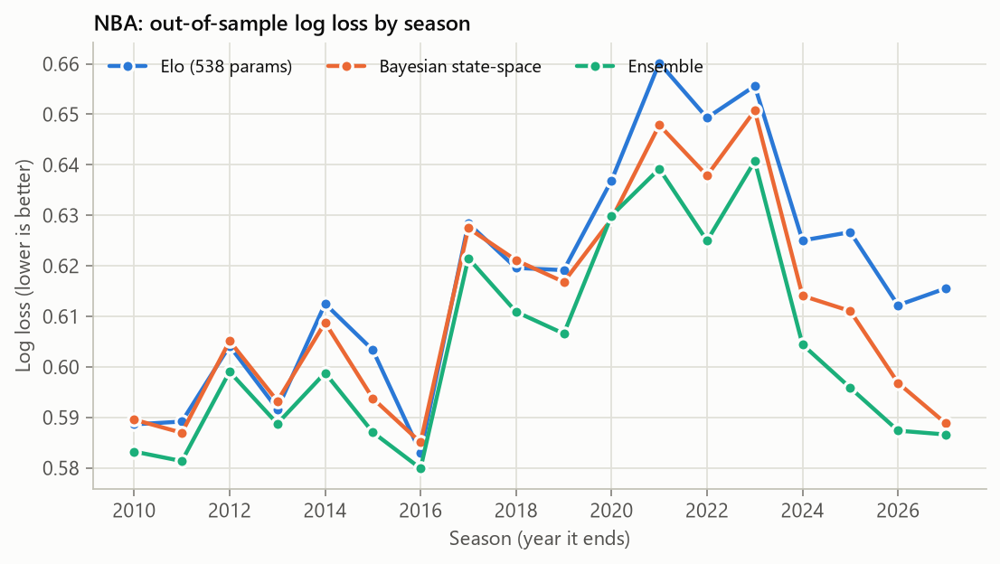
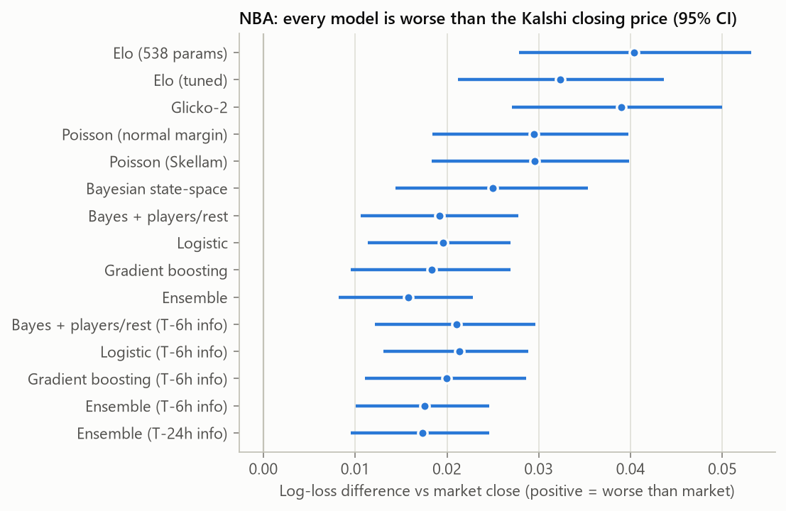
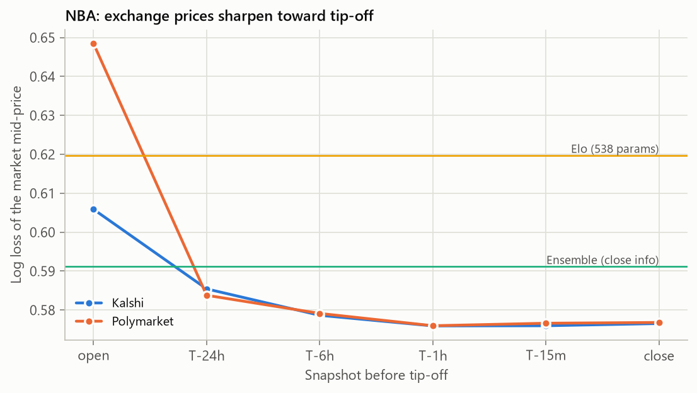
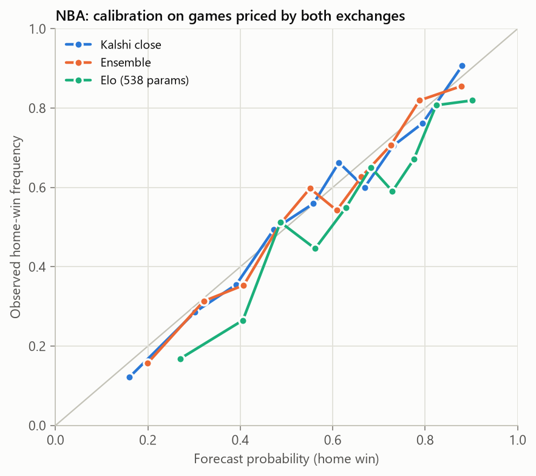
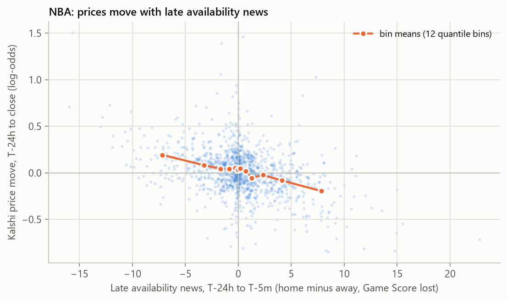
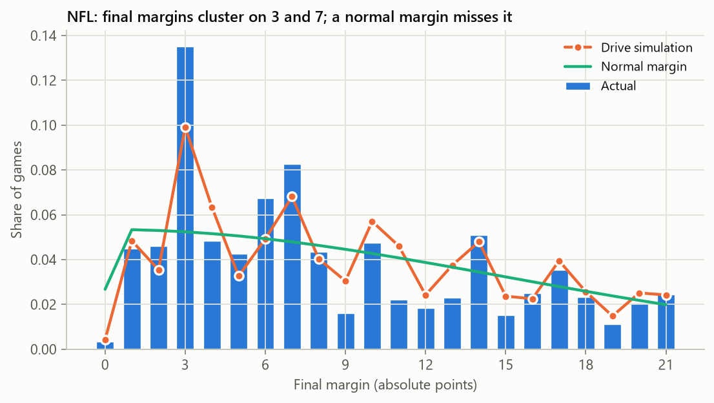
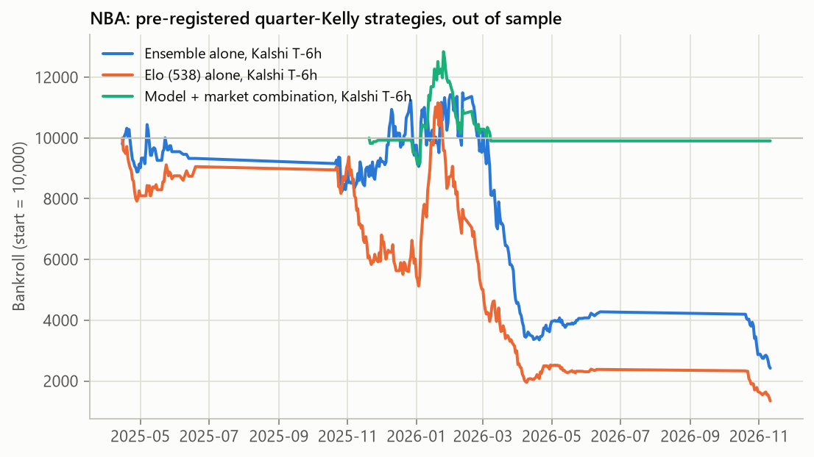

# Do models beat the closing line? Probability models against exchange and sportsbook prices in the NBA and NFL

Research note, November 2026. Every number below is generated from the result files in
<code>outputs/</code> by <code>scripts/build_paper.py</code>; the code and data pipeline are in this repository.

## Abstract

We assemble a leakage-controlled research platform from open data: NBA and NFL results, box scores,
official injury reports with publication timestamps, sportsbook closing lines (NFL), and order-book price
histories from two prediction-market exchanges, Kalshi and Polymarket. We fit Elo, Glicko-2, Poisson,
a Bayesian dynamic state-space model, player-availability adjustments, walk-forward logistic regression and
gradient boosting, and compare them with margin-free market probabilities. Across
{{v:nba/summary.json:longrun_n|int}} out-of-sample NBA games the best model, an ensemble, lowers log loss
relative to FiveThirtyEight-style Elo by {{x:nba_ens_vs_elo|.4f}} (95% CI {{x:nba_ens_vs_elo_lo|.4f}} to
{{x:nba_ens_vs_elo_hi|.4f}}). Against Kalshi closing prices on {{v:nba/summary.json:market_kalshi_n|int}}
games the same ensemble is worse by {{x:nba_ens_gap|.4f}} (95% CI {{x:nba_ens_gap_lo|.4f}} to
{{x:nba_ens_gap_hi|.4f}}), and in a forecast-encompassing regression its weight is
{{x:nba_enc_ens_b|.2f}} (SE {{x:nba_enc_ens_se|.2f}}): the closing price already contains everything the
model knows. The NFL tells the same story against devigged sportsbook closing moneylines
({{v:nfl/summary.json:book_ml_n|int}} games). Schedule, fatigue and late injury news move prices but leave no
detectable residual in closing prices after correcting for {{x:nba_eff_n_tests|int}} simultaneous tests.
Day-ahead prices are less efficient: the model's T-24h disagreement predicts the price's move to the close,
and bets placed 24 hours out beat the closing price by {{x:bt_ens24_avg_clv|pp}} points on average
(95% CI {{x:bt_ens24_clv_lo|pp}} to {{x:bt_ens24_clv_hi|pp}}), but that is less than Kalshi's taker fee and
spread. Pre-registered fractional-Kelly strategies built on model-versus-market disagreement lose money after
costs, and the one decision rule that respects the evidence, a walk-forward combination of model and price,
mostly abstains.__PROPS_ABSTRACT__ The result is a careful negative: on these markets, public-information models do not find
mispricing at the close that survives costs.

## 1. Question and approach

Sports betting markets are a clean laboratory for market efficiency: every contract settles on an observable
outcome within hours. The research question is whether probabilities built from public information
systematically disagree with market prices in a way that the outcomes vindicate. We deliberately do not
optimise for historical return; the yardstick is out-of-sample forecast accuracy measured with proper scoring
rules, calibration, forecast encompassing, and closing-line value (CLV), with betting simulations used only as
a stress test of those measurements under realistic costs.

Three design choices drive the results:

1. **Margin-free market probabilities.** Bookmaker prices are devigged with five methods (multiplicative,
   additive, power, Shin, odds-ratio). Exchange prices are mids of executable order books; Kalshi's two
   team-books are combined, and their ask-implied overround is reported as the exchange analogue of vig.
2. **Point-in-time information.** Every input carries a timestamp. Ratings update only with results from
   earlier calendar days; injury reports count only if published before the decision time; bets trade the ask
   that existed at the decision time.
3. **Out-of-sample by construction.** Rating hyperparameters are fitted on 2004-2015 (NBA) and 2002-2012 (NFL);
   learned models are walk-forward by season; the betting rules were fixed before any backtest was run.

## 2. Data

| Source | Content | Coverage used |
|---|---|---|
| sportsdataverse (MIT) | NBA schedules, box scores, official injury reports with publication time | 1996-97 to 2026-27; reports from Dec 2018 |
| nflverse (CC-BY-4.0) | NFL games, closing moneyline / spread / total with prices, starting QBs, weekly injuries, player stats | 1999 to 2026 |
| Kalshi public API | Game-winner order books: 1-minute and hourly bid / ask / trade candles | NBA Apr 2025 to Nov 2026; NFL Aug 2025 to Nov 2026 |
| Polymarket public API | Moneyline, spread and total price histories | NBA Apr 2024 to Nov 2026; NFL 2024 to 2026 |

All of it lands in a SQLite historical odds database (`data/db/sports.sqlite`) with UTC timestamps for
tip-off, result availability, every exchange quote and every injury report. Two candidate sources were
excluded: the SportsbookReviewsOnline archive, the longest free NBA sportsbook history, because its terms
forbid use without consent, and two odds-file sites whose robots.txt disallows Anthropic's crawlers.
`DATA_SOURCES.md` documents each check. The consequence is that NBA sportsbook history is absent and the NBA
market comparison rests on exchange prices from April 2024 onward.

Market samples (NBA): Kalshi closing prices for {{v:nba/summary.json:market_kalshi_n|int}} games
({{v:nba/summary.json:market_kalshi_dates.0}} to {{v:nba/summary.json:market_kalshi_dates.1}}), Polymarket for
{{v:nba/summary.json:market_polymarket_n|int}} ({{v:nba/summary.json:market_polymarket_dates.0}} onward), both
for {{v:nba/summary.json:market_common_n|int}}. Kalshi's closing books are tight: the mean ask-implied
overround is {{v:nba/summary.json:kalshi_close_overround_mean|pct}} at the close against
{{v:nba/summary.json:kalshi_open_overround_mean|pct}} at listing. The NFL sportsbook closing moneyline carries a
mean overround of {{v:nfl/summary.json:book_overround_mean|pct}}.

## 3. Models

* **Elo** with FiveThirtyEight's published NBA/NFL settings (K = 20, home edge 100 / 48 Elo points,
  margin-of-victory multiplier with autocorrelation correction, 75% / 67% carry-over) as the benchmark, and a
  version tuned by log loss on the training seasons.
* **Glicko-2** with per-game rating periods and deviation growth over idle days.
* **Poisson attack/defence** with exponential time decay, refitted every game day; win probabilities read
  out both as Skellam and as a Gaussian margin with an empirically tracked residual SD.
* **Bayesian dynamic state-space model**: team offence and defence follow random walks, league scoring level
  and home advantage are latent states, and a hierarchical prior partially pools teams toward the league mean
  each summer. Exact Kalman filtering yields the posterior after each game and the marginal likelihood used to
  fit hyperparameters by empirical Bayes; the predictive distribution gives moneyline, spread and total
  probabilities jointly.
* **Player availability (NBA)**: pre-game Game Score per 36 minutes and expected minutes for every player give
  the value a team loses when a player sits; expected absences come from the last official injury report
  before the decision time and are measured against what the ratings already absorbed.
  **Starting quarterback (NFL)**: pre-game EPA per play of the announced starter versus the previous starter.
* **Walk-forward logistic regression and LightGBM** on rating outputs, schedule, travel, altitude and
  availability features, and a **margin-adjusted state-space model**; the **ensemble** averages the three in
  log-odds. Three information sets (injury reports up to T-24h, T-6h, T-5m) are kept separate.
* **Monte Carlo simulators**: a possession model for the NBA (with player-points allocation for props) and a
  drive model for the NFL that reproduces scoring in 3s and 7s.

Fitted rating hyperparameters (training seasons only) are in `outputs/<league>/params.json`; for example the
tuned NBA Elo uses K = {{v:nba/params.json:elo_tuned.k|.1f}} and a home edge of
{{v:nba/params.json:elo_tuned.hca|.0f}} Elo points, and the state-space model's fitted season carry-over is
{{v:nba/params.json:kalman_fitted.carry|.2f}}.

## 4. NBA moneyline: models against each other

Out-of-sample seasons 2015-16 to 2026-27 ({{v:nba/summary.json:longrun_n|int}} games):

{{t:nba/longrun_metrics.csv|model:Model,log_loss:Log loss:.4f,brier:Brier:.4f,accuracy:Accuracy:pct,cal_slope:Calibration slope:.2f,ece:ECE:.3f}}

Every model beats the Elo benchmark (paired, date-clustered bootstrap, largest p-value
{{x:nba_max_vs_elo_p|.3f}}; `outputs/nba/longrun_paired_vs_elo538.csv`). The ensemble lowers log loss by
{{x:nba_ens_vs_elo|.4f}}. Availability and rest information matter: adding them to the state-space model lowers
log loss from {{c:nba/longrun_metrics.csv:model=Bayesian state-space:log_loss|.4f}} to
{{c:nba/longrun_metrics.csv:model=Bayes + players/rest:log_loss|.4f}}. Calibration slopes below one indicate mild
over-confidence out of sample.

## 5. NBA moneyline: models against markets

On the {{v:nba/summary.json:market_kalshi_n|int}} games with a Kalshi closing price:

{{t:nba/market_kalshi_metrics.csv|model:Forecast,log_loss:Log loss:.4f,brier:Brier:.4f,cal_slope:Calibration slope:.2f,cal_intercept:Intercept:.2f|model=Kalshi close;Kalshi T-15m;Kalshi T-1h;Kalshi T-6h;Kalshi T-24h;Kalshi open;Ensemble;Ensemble (T-6h info);Ensemble (T-24h info);Bayes + players/rest;Gradient boosting;Bayesian state-space;Elo (538 params)}}

Three findings.

**The close beats every model.** The ensemble is {{x:nba_ens_gap|.4f}} log loss worse than the Kalshi close
(95% CI {{x:nba_ens_gap_lo|.4f}} to {{x:nba_ens_gap_hi|.4f}}); Elo is {{x:nba_elo_gap|.4f}} worse.

**The close encompasses the models.** Regressing outcomes on the log-odds of both the closing price and a model,
the model's coefficient is {{x:nba_enc_ens_b|.2f}} (SE {{x:nba_enc_ens_se|.2f}}, p = {{x:nba_enc_ens_p|.2f}})
for the ensemble, and the smallest p-value across all models is {{x:nba_enc_min_p|.2f}}. Against the noisier
Polymarket close the ensemble's weight is {{x:nba_enc_pm_ens_b|.2f}} (p = {{x:nba_enc_pm_ens_p|.2f}}):
suggestive, not significant.

**Prices learn, models sit in between.** Market accuracy improves from listing to tip-off: Kalshi log loss
{{x:nba_ll_k_open|.4f}} at listing, {{x:nba_ll_k_t24|.4f}} at T-24h, {{x:nba_ll_k_t6|.4f}} at T-6h and
{{x:nba_ll_k_close|.4f}} at the close. The ensemble ({{x:nba_ll_ens|.4f}}) scores better than the opening
price and worse than the price a day before tip-off. Opening books are also the widest (mean ask-implied
overround {{v:nba/summary.json:kalshi_open_overround_mean|pct}}), so a better score at the open says nothing yet
about a tradeable edge.

### Calibration, favourite-longshot bias, devig methods, venues

The Kalshi close is well calibrated (slope {{v:nba/summary.json:flb_kalshi_close.slope|.2f}}, SE
{{v:nba/summary.json:flb_kalshi_close.slope_se|.2f}}); there is no favourite-longshot bias at the close. The
opening price is too compressed toward 50% (slope {{v:nba/summary.json:flb_kalshi_open.slope|.2f}}, SE
{{v:nba/summary.json:flb_kalshi_open.slope_se|.2f}}). With overround under 1%, the devig method is
immaterial on Kalshi:

{{t:nba/devig_kalshi_close.csv|model:Method,log_loss:Log loss:.5f,cal_slope:Calibration slope:.3f}}

Kalshi and Polymarket closes are near-identical: correlation {{v:nba/summary.json:venue_gap.corr|.4f}}, mean
absolute gap {{v:nba/summary.json:venue_gap.mean_abs|pts}} points, 90th percentile
{{v:nba/summary.json:venue_gap.p90_abs|pts}} points.

## 6. Market-efficiency tests

Each test asks whether public information known before the close predicts the outcome *after* conditioning on
the closing price (logistic regression with the market log-odds as offset; date-clustered errors;
Benjamini-Hochberg across {{x:nba_eff_n_tests|int}} NBA hypotheses).

{{t:nba/efficiency_tests.csv|test:Test,term:Variable,coef:Coefficient:.3f,se:SE:.3f,p_value:p:.3f,p_bh:BH-adjusted p:.3f|in_family=True}}

Raw p-values below 0.05: {{x:nba_eff_n_raw05|int}} of {{x:nba_eff_n_tests|int}}; the smallest BH-adjusted
p-value is {{x:nba_eff_min_pbh|.2f}}. The information itself is real. In the training seasons (outcomes only, no
market) a back-to-back costs {{x:nba_eff_b2b_diff_abs|.2f}} points of margin (SE {{x:nba_eff_b2b_diff_se|.2f}}),
playing at altitude is worth {{x:nba_eff_home_altitude|.2f}} (SE {{x:nba_eff_home_altitude_se|.2f}}), and each
unit of lost Game Score costs {{x:nba_eff_lost_delta_5_abs|.3f}} points (SE {{x:nba_eff_lost_delta_5_se|.3f}}).
The market prices it: each unit of late injury news between T-24h and T-5m moves the Kalshi price
{{x:nba_reprice_kalshi_abs|.4f}} log-odds against the team that lost the player (descriptive regression,
p < 0.001), and none of it is left in the closing price.

**Day-ahead prices drift toward public information.** Using only information available 24 hours before tip-off, the gap
between the ensemble and the Kalshi price predicts how the price moves before the close: the price closes
{{x:drift_kalshi|.2f}} of the log-odds gap (SE {{x:drift_kalshi_se|.2f}}, R-squared
{{x:drift_kalshi_r2|.2f}}); on Polymarket, whose day-ahead book is thinner, {{x:drift_polymarket|.2f}} (SE
{{x:drift_polymarket_se|.2f}}). Prices drift toward public information during the last day and arrive at a
close that contains it. Section 9 shows the drift is real but smaller than the cost of trading on it.

NFL tests on the sportsbook close (2010 onward; {{x:nfl_eff_n_tests|int}} hypotheses, smallest BH-adjusted p
{{x:nfl_eff_min_pbh|.2f}}): home bias, divisional and playoff games, rest and travel, quarterback changes and
the ensemble's edge all fail to predict outcomes beyond the price.

{{t:nfl/efficiency_tests.csv|test:Test,term:Variable,coef:Coefficient:.3f,se:SE:.3f,p_value:p:.3f,p_bh:BH-adjusted p:.3f|in_family=True}}

## 7. NFL: moneylines, spreads, totals

On {{v:nfl/summary.json:book_ml_n|int}} games (2013-2026) the devigged sportsbook close is the benchmark:

{{t:nfl/book_ml_metrics.csv|model:Forecast,log_loss:Log loss:.4f,brier:Brier:.4f,cal_slope:Calibration slope:.2f}}

The best model (logistic) trails the close by {{x:nfl_best_gap|.4f}} (95% CI {{x:nfl_best_gap_lo|.4f}} to
{{x:nfl_best_gap_hi|.4f}}); no model's encompassing weight is significant (smallest p
{{x:nfl_enc_min_p|.2f}}). The power method gives the best-calibrated moneyline probabilities; the multiplicative
method leaves a mild, not significant favourite-longshot pattern (slope {{v:nfl/summary.json:flb_book.slope|.2f}},
SE {{v:nfl/summary.json:flb_book.slope_se|.2f}}).

**Spreads.** Home teams covered {{v:nfl/summary.json:spread_cover_rate_home|pct}} of
{{v:nfl/summary.json:spread_n|int}} decided spreads and favourites {{v:nfl/summary.json:spread_favourite_cover_rate|pct}},
both within sampling error of the devigged 50%. Model cover probabilities lose to the market's coin flip:

{{t:nfl/spread_metrics.csv|model:Forecast,log_loss:Log loss:.4f,brier:Brier:.4f}}

The drive simulator captures most of the NFL's clustering on key numbers, which a normal margin cannot:
{{v:nfl/summary.json:key_numbers.actual_share_3|pct}} of games are decided by exactly 3 points, the simulator
gives {{v:nfl/summary.json:key_numbers.sim_share_3|pct}} and a normal margin
{{v:nfl/summary.json:normal_share_3|pct}}. Its cover probabilities are still no better than the normal model's:
pricing a spread depends more on where the margin distribution is centred than on its shape.

**Totals.** Overs hit {{v:nfl/summary.json:total_over_rate|pct}} of {{v:nfl/summary.json:total_n|int}} games.
In {{v:nfl/summary.json:total_n_wind15|int}} games with wind of 15 mph or more the over hit
{{v:nfl/summary.json:total_over_rate_wind15|pct}} against a devigged price of
{{v:nfl/summary.json:total_book_p_over_wind15|pct}} (two-sided p = {{x:nfl_wind_p|.2f}}, normal approximation,
before any multiple-testing adjustment). It is a single subgroup, and it uses game-time wind that is only
approximately known before kickoff.

**Exchanges against sportsbooks.** On {{v:nfl/summary.json:exchange_common_n|int}} games priced by all
three, Kalshi and Polymarket closes match the sportsbook close (mean absolute Kalshi-book gap
{{v:nfl/summary.json:kalshi_minus_book_mean_abs|pts}} points):

{{t:nfl/exchange_vs_book.csv|model:Forecast,log_loss:Log loss:.4f,brier:Brier:.4f}}

## 8. NBA spreads, totals and player props

__LINES_PROPS__

## 9. Backtests

Pre-registered rule, fixed before any run: quarter Kelly on the model's probability, a minimum edge of 2
points after all costs, at most 2% of bankroll per bet and 15% per day, bets sized off the start-of-day
bankroll, Kalshi taker fees (0.07 x P x (1 - P) per contract, rounded up per order), executable asks only, stake
at most 2% of the game's pre-tip volume. Each decision time uses its own information set.

| Strategy | Bets | ROI | ROI 95% CI | CLV (points) | CLV after costs | Max drawdown |
|---|---:|---:|---:|---:|---:|---:|
| Ensemble, Kalshi T-6h | {{x:bt_ens6_n_bets|int}} | {{x:bt_ens6_roi|pct}} | {{x:bt_ens6_roi_lo|pct}} to {{x:bt_ens6_roi_hi|pct}} | {{x:bt_ens6_avg_clv|pp}} | {{x:bt_ens6_avg_clv_after_cost|pp}} | {{x:bt_ens6_max_drawdown|pct}} |
| State-space + players, Kalshi T-6h | {{x:bt_kp6_n_bets|int}} | {{x:bt_kp6_roi|pct}} | {{x:bt_kp6_roi_lo|pct}} to {{x:bt_kp6_roi_hi|pct}} | {{x:bt_kp6_avg_clv|pp}} | {{x:bt_kp6_avg_clv_after_cost|pp}} | {{x:bt_kp6_max_drawdown|pct}} |
| Elo (538), Kalshi T-6h | {{x:bt_elo6_n_bets|int}} | {{x:bt_elo6_roi|pct}} | {{x:bt_elo6_roi_lo|pct}} to {{x:bt_elo6_roi_hi|pct}} | {{x:bt_elo6_avg_clv|pp}} | {{x:bt_elo6_avg_clv_after_cost|pp}} | {{x:bt_elo6_max_drawdown|pct}} |
| Ensemble, Kalshi T-24h | {{x:bt_ens24_n_bets|int}} | {{x:bt_ens24_roi|pct}} | {{x:bt_ens24_roi_lo|pct}} to {{x:bt_ens24_roi_hi|pct}} | {{x:bt_ens24_avg_clv|pp}} | {{x:bt_ens24_avg_clv_after_cost|pp}} | {{x:bt_ens24_max_drawdown|pct}} |
| Ensemble, Kalshi close | {{x:bt_ensc_n_bets|int}} | {{x:bt_ensc_roi|pct}} | {{x:bt_ensc_roi_lo|pct}} to {{x:bt_ensc_roi_hi|pct}} | {{x:bt_ensc_avg_clv|pp}} | {{x:bt_ensc_avg_clv_after_cost|pp}} | {{x:bt_ensc_max_drawdown|pct}} |
| Model + market combination, Kalshi T-6h | {{x:bt_comb6_n_bets|int}} | {{x:bt_comb6_roi|pct}} | {{x:bt_comb6_roi_lo|pct}} to {{x:bt_comb6_roi_hi|pct}} | {{x:bt_comb6_avg_clv|pp}} | {{x:bt_comb6_avg_clv_after_cost|pp}} | {{x:bt_comb6_max_drawdown|pct}} |
| Ensemble, Polymarket T-6h (no fee, 1-point half-spread) | {{x:bt_pm6_n_bets|int}} | {{x:bt_pm6_roi|pct}} | {{x:bt_pm6_roi_lo|pct}} to {{x:bt_pm6_roi_hi|pct}} | {{x:bt_pm6_avg_clv|pp}} | {{x:bt_pm6_avg_clv_after_cost|pp}} | {{x:bt_pm6_max_drawdown|pct}} |
| NFL ensemble, sportsbook close 2013-2026 | {{x:bt_nflbook_n|int}} | {{x:bt_nflbook_roi|pct}} | {{x:bt_nflbook_lo|pct}} to {{x:bt_nflbook_hi|pct}} | 0 by construction | | {{x:bt_nflbook_dd|pct}} |

Reading the table:

* A model that is less accurate than the market still disagrees with it on most games, and Kelly sizing
  treats every disagreement as edge. The ensemble's T-6h picks are bought at roughly the closing fair price:
  CLV, measured against the ask actually paid, is {{x:bt_ens6_avg_clv|pp}} points. The taker fee
  ({{x:bt_ens6_avg_fee|pts}} points per contract on average) turns that into {{x:bt_ens6_avg_clv_after_cost|pp}},
  so the expected return at closing prices is {{x:bt_ens6_exp_roi_at_close|spct}} and the realised
  {{x:bt_ens6_roi|spct}} is that expectation plus noise.
* The risk limits did not prevent deep drawdowns, because the binding risk is a biased probability, not bet
  size. A strategy's edge estimate is only as good as its probability, and here the probability is worse than
  the price it bets against.
* The day-ahead drift of Section 6 is visible in the T-24h strategy: its bets beat the close by
  {{x:bt_ens24_avg_clv|pp}} points on average (95% CI {{x:bt_ens24_clv_lo|pp}} to {{x:bt_ens24_clv_hi|pp}}),
  the only reliably positive CLV in the study. Kalshi's taker fee ({{x:bt_ens24_avg_fee|pts}} points) is larger,
  so CLV after costs is {{x:bt_ens24_avg_clv_after_cost|pp}} points and the expected return at closing prices
  {{x:bt_ens24_exp_roi_at_close|spct}}: predictable drift that stays inside the band trading costs allow, which
  is what efficiency net of costs predicts. Whether resting limit orders (lower maker fee, no spread crossing)
  could keep the drift is open; testing it needs order-book depth and fill data that are not in this dataset.
* The combination rule estimates, from earlier games only, how much weight the model deserves next to the
  price. Because that weight is close to zero, the combined probability collapses onto the price and the rule
  places {{x:bt_comb6_n_bets|int}} bets out of {{x:bt_comb6_universe_games|int}} eligible games.

**A leakage check.** A first run fed the T-24h strategy with injury information from T-6h, up to 18 hours of
news the market had not yet seen. That version showed a CLV of {{x:bt_leak24_avg_clv|pp}} points against
{{x:bt_ens24_avg_clv|pp}} with the correct T-24h information set, and a return of {{x:bt_leak24_roi|pct}}
against {{x:bt_ens24_roi|pct}}. The look-ahead inflated CLV, though here most of the T-24h CLV turned out to
be the genuine drift above. The correct pairing of decision time and information set is enforced in code and
tested.

Sensitivity (`outputs/nba/backtest_grid.csv`): Kelly fractions 0.1-0.5, minimum edges 1-5 points and slippage
of 0 or 1 point are reported for every strategy; they were not used to choose the configuration above.

## 10. Limitations

* **Short exchange history.** NBA exchange prices span parts of three seasons; the 95% intervals above are
  the honest measure of what that sample can say. A sportsbook history for the NBA would lengthen it, but the
  free one available forbids use without consent.
* **Venue costs.** Polymarket's fee schedule for sports has changed over time; its backtests assume no fee and
  a one-point half-spread, and report sensitivity instead of a single number.
* **Timing approximations.** NBA tip-off times come from the ESPN schedule redistributed by sportsdataverse;
  NFL starting quarterbacks are the actual starters (normally announced before kickoff); NFL wind is game-time
  weather. Each is flagged where it enters.
* **Player-availability proxy.** Before the 2018-19 season (no injury-report archive) availability is read from
  the game's own inactive list, which is public before tip-off but would not be available at T-24h; those
  seasons are training data only.
* **Props.** The discovery sample is a random 15% of games (125 after matching) and the replication uses the
  rest (728); both cover January to November 2026, so the replication is out of sample in games but not in time.
  The registered props code scored outcomes from the box score, while Kalshi settles props on players who do not
  play at a pre-game fair price; Section 8's settlement-consistent numbers are the ones to rely on, and the
  default props pipeline now scores that way.

## 11. Reproducibility

`README.md` lists the commands that rebuild every table and figure from an empty cache; raw responses are
cached with their fetch time and hash in `data/raw/*/_manifest.jsonl`. The leakage tests in
`tests/test_leakage.py` perturb future results, same-day results, test-season outcomes, late injury reports and
closing prices and verify that no earlier prediction or bet changes.
